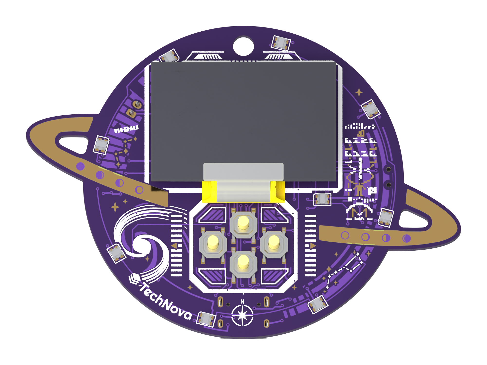
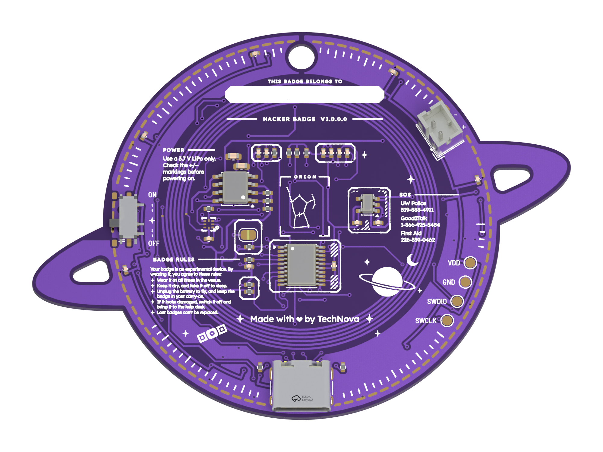
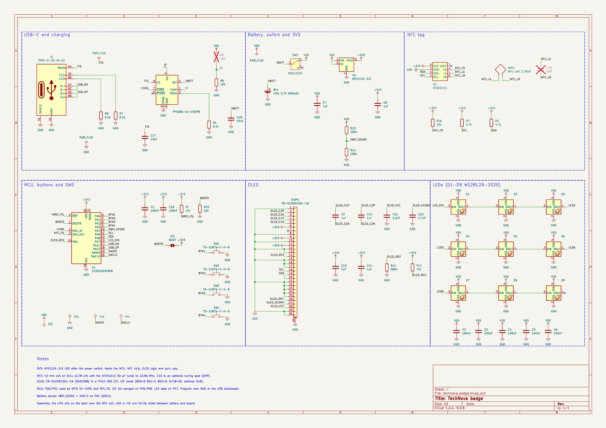
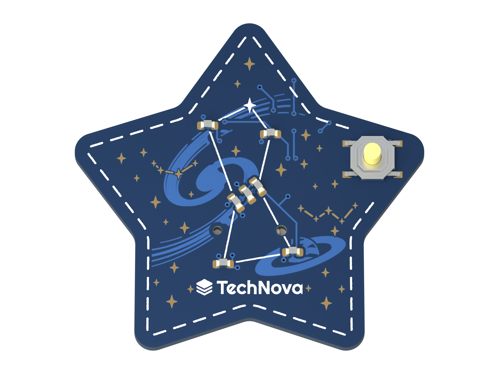
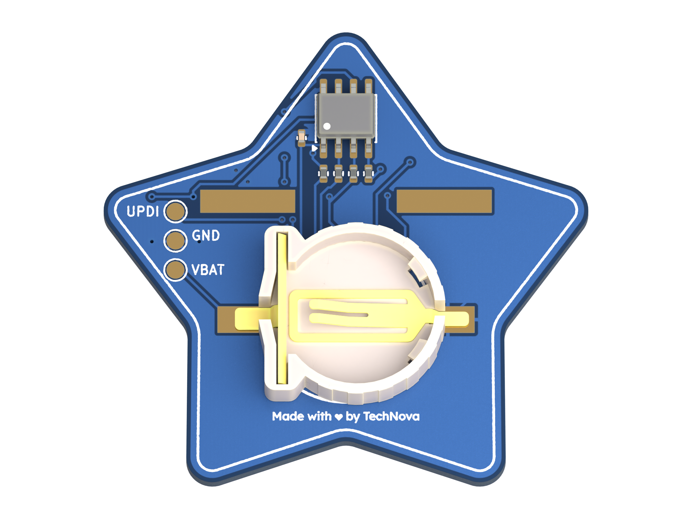
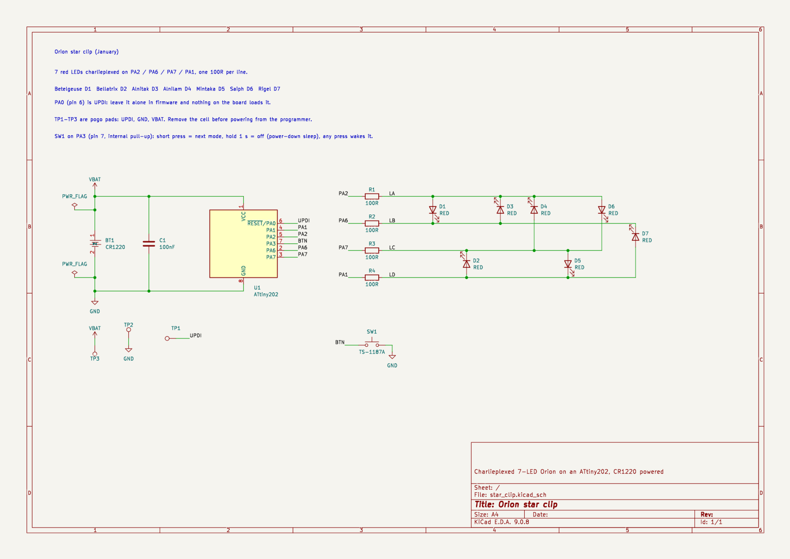

# TechNova PCBs

KiCad 9 source files and schematics for the TechNova hacker badge and star clip.

## Planet badge

  
  

- CH32V203 RISC-V microcontroller
- 1.3" 128x64 OLED and a 4-button d-pad
- 9 WS2812B-2020 addressable LEDs
- NFC tag (NT3H2111) with an on-board coil, so you can tap it with a phone
- USB-C charging for a 3.7 V LiPo (TP4056), with a power slide switch
- SWD test pads on the back for programming
- 81.4 x 60 mm, 2 layers, purple mask with ENIG gold art

Files are in `technova-badge/`, schematic PDF is `technova-badge/technova_badge-schematic.pdf`.

## Star clip

  
  

- Orion drawn in 7 red 0603 LEDs
- ATtiny202, programmed over UPDI
- One button for modes and soft power off
- Runs off a CR1220 coin cell
- 41 x 39 mm, 2 layers, blue mask with ENIG gold art

Files are in `star-clip/`, schematic PDF is `star-clip/star_clip-schematic.pdf`.
